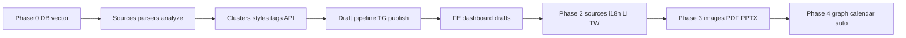

# APEX Module 4 — Content Engine: план реализации

Документ основан на **APEX_M4_Content_Engine_TZ.md v3.0** и текущем состоянии репозитория (FastAPI, SQLAlchemy 2, Alembic, Celery, Redis, Supabase JWT, `AIRouter`, multi-tenant `organisations` / `users`).

---

## 1. Цели и критерии готовности

**Цель:** реализовать полный цикл Content Engine — источники → `raw_posts` → анализ и кластеризация → черновики (pipeline) → фактчек → публикация (ручная и авто), плюс календарь, пресеты стилей/картинок, теги и knowledge graph на pgvector.

**Минимальный сквозной критерий (MVP из ТЗ §12):**

- Миграции всех таблиц из §1 ТЗ, включая расширение `vector` и индексы IVFFlat (или HNSW при миграции на поддерживаемый вариант).
- CRUD источников + ручной/почасовой парсинг → записи в `raw_posts`.
- После сохранения поста: summary + теги + embedding; дедупликация по `content_hash`.
- Кластеризация топиков после цикла парсинга.
- Создание драфта → последовательный pipeline со статусами в `content_drafts.pipeline_status` и опросом `GET .../drafts/{id}/status`.
- Форматы v1: как минимум Telegram + LinkedIn post + Twitter (согласно Phase 1 ТЗ).
- Фактчек (Perplexity через существующий роутинг `company_research` / Sonar Pro по таблице ТЗ §2.2).
- Публикация в Telegram (Phase 1); Twitter/LinkedIn — Phase 2.
- UI: Dashboard, Raw Posts, Clusters, Create Draft, Drafts List (Phase 1).

---

## 2. Зависимости от Foundation (уже в репо)

| Компонент Foundation | Использование в M4 |
|------------------------|------------------|
| `get_current_user`, `org_id` из `User` | Все API под префиксом `/api/v1/content/*` с фильтрацией по `org_id`. |
| `AsyncSession` / `get_db` | Репозитории и сервисы модуля. |
| `AIRouter`, `TaskType` | Все LLM-вызовы: `SUMMARY`, `CONTENT_SYNTHESIS`, `TEXT_GENERATION`, `COMPANY_RESEARCH` (фактчек), расширение под **реальную** генерацию изображений. |
| `log_ai_usage` / лимиты | Каждый шаг pipeline и парсинг-анализ с `module="content"`. |
| Celery `celery_app`, очередь `modules` | Задачи в `app.modules.content.tasks` (уже предусмотрено `task_routes` в `celery_app.py`). |
| Исключения, логирование | Единый стиль ошибок API. |

**Доработки Foundation под M4 (обязательные):**

1. **`ai_router`:** в ТЗ для image generation указан **Gemini Imagen 3**; в текущем `ROUTING_TABLE` для `IMAGE_GENERATION` стоит Claude — нужен отдельный путь (Google Generative AI / Imagen) + fallback DALL-E при наличии ключа OpenAI, с логированием токенов/стоимости по правилам проекта.
2. **Embeddings:** OpenAI `text-embedding-3-small` (1536) — либо тонкая обёртка рядом с `AIRouter`, либо отдельный сервис; учёт в квотах/стоимости.
3. **`celery_app.conf.beat_schedule`:** сейчас пустой — добавить задачи из ТЗ §7 (parse hourly, recommendations `/6h`, auto-publish check, archive clusters).
4. **`celery_app.autodiscover_tasks`:** подключить `app.modules.content` (или явный include пакета задач).

---

## 3. Архитектура модуля в кодовой базе

Рекомендуемая структура (согласовано с ТЗ §10):

```
backend/app/modules/content/
  __init__.py
  models.py              # SQLAlchemy-модели по схеме §1
  schemas/               # Pydantic request/response
  repositories/          # Доступ к данным (org-scoped)
  services/              # Парсеры, pipeline steps, graph, recommendations
  parsers/               # telegram, rss, youtube, imap, web
  prompts/               # Шаблоны из ТЗ §3 (константы или Jinja)
  tasks.py               # Celery: parse, analyze, cluster, pipeline, publish
  router.py              # FastAPI include → /content
```

Регистрация:

- Alembic: `env.py` — импорт моделей content.
- `app/api/router.py` — `include_router(..., prefix="/content")` при общем префиксе `/api/v1` или полный путь как в ТЗ §6.

---

## 4. Фаза 0 — Инфраструктура БД и секреты (3–5 дней)

| Шаг | Работа |
|-----|--------|
| 0.1 | Включить расширение PostgreSQL `pgvector`; проверить совместимость версии PG в docker-compose. |
| 0.2 | Одна миграция Alembic (или разбить на 2: схема + индексы): все таблицы §1.1–§1.12, FK на `organisations`, `users`, внутренние FK между таблицами модуля. |
| 0.3 | Индексы: как в ТЗ; для IVFFlat — параметр `lists` под ожидаемый объём (можно консервативно, потом tune). |
| 0.4 | Шифрование/маскирование `connection_config` (Telegram session, IMAP пароли): минимум — KMS/app secret + Fernet в приложении; ключи в env. |
| 0.5 | Зависимости Python: `telethon`, `feedparser`, `yt-dlp`, `httpx`, при необходимости `crawl4ai`, `imaplib` (stdlib) — зафиксировать в `requirements` / lockfile. |

**Риски:** уникальный `(org_id, content_hash)` — обработка `IntegrityError` при вставке (идемпотентный парсинг).

---

## 5. Фаза 1 — Core loop (≈3 недели, календарь ТЗ §11 Phase 1)

### 5.1 Источники и парсинг

| Подзадача | Детали |
|-----------|--------|
| Модель + API §6.1 | CRUD `content_sources`; валидация `source_type`; уникальность `(org_id, source_type, source_id)`. |
| `parse_source` | Celery-задача: диспетчер по `source_type`; обновление `last_parsed_at`, `error_count`, `last_error`. |
| Telegram | Telethon user session из `connection_config`; лимит сообщений, фильтры keywords / `min_post_length` из ТЗ §4.1. |
| RSS | feedparser, cutoff по `last_parsed_at` как в §4.2. |
| Сохранение в `raw_posts` | Поля из §1.2; вычисление `content_hash` (MD5 первых 500 символов). |
| После вставки | Асинхронно (или цепочкой Celery): `analyze_raw_post` — summary (промпт §3.1), теги (§3.2), embedding, `status`, `analyzed_at`. |

### 5.2 Кластеризация

| Подзадача | Детали |
|-----------|--------|
| `cluster_topics(org_id)` | По расписанию после батча или ручной `POST .../clusters/refresh`; промпт §3.3; запись `topic_clusters`, обновление `raw_posts.cluster_id`. |
| `expires_at` / архив | Задача `archive_old_clusters` (ежедневно). |

### 5.3 Конфиг тегов и стили

| Подзадача | Детали |
|-----------|--------|
| `tags_config` | API §6.10; сиды системных тегов при первом запуске org (опционально). |
| `style_presets` | API §6.9; минимум один default на org; поля для pipeline §3.4–3.5. |

### 5.4 Pipeline черновика (Celery)

Реализовать оркестратор `run_draft_pipeline(draft_id)` и шаги из ТЗ §2.1:

1. **Synthesis** — `TaskType.CONTENT_SYNTHESIS`, промпт §3.4 → `synthesized_text`.
2. **Style** — `TEXT_GENERATION`, §3.5 → `styled_text`.
3. **Formatting** — параллельно подпроцессы/группа задач: Telegram §3.6, LinkedIn §3.7, Twitter §3.8 → соответствующие поля драфта.
4. **Translation** — отложить полностью на Phase 2 или сделать только `en` как no-op; если делать частично — Haiku `SUMMARY`/отдельный вызов по §3.9.
5. **Fact check** — Perplexity JSON §3.10 → `fact_check_results` + агрегат в `content_drafts`.
6. **Image analysis/generation** — в Phase 1 можно stub (пропуск шага 6–7) или только analysis без Imagen до Phase 3.
7. **Graph links** — в Phase 1 можно упростить: только embeddings + заполнение `related_*` на драфте без полноценного `content_links` до Phase 4.

Обновление `pipeline_status` после каждого шага; при ошибке — retry 3x backoff (ТЗ §9), затем `failed` + `pipeline_error`.

### 5.5 API черновиков и кастомный ввод

- §6.4: создание драфта из `source_post_ids` и/или `cluster_id`; опрос статуса.
- §6.5 (минимум): `custom-input/text`; URL/YouTube — по мере готовности парсеров.

### 5.6 Публикация (MVP)

- Запись в `published_posts` + отправка в Telegram (bot API или тот же канал, что зафиксирован в Foundation/настройках org — уточнить в `content/settings` или `organisations.settings`).
- `POST .../drafts/{id}/publish` с телом `platforms`, `languages`, опционально `scheduled_at` → при отсрочке строка в `content_calendar`.

### 5.7 Frontend (Phase 1)

Экраны ТЗ §8.1, §8.2, §8.3, §8.4, §8.5: статистика, рекомендации (можно заглушка до `generate_recommendations`), таблица сырья, кластеры, мастер драфта с прогресс-баром по шагам, список драфтов.

---

## 6. Фаза 2 — Источники и переводы (≈2 недели)

| Блок | Работа |
|------|--------|
| YouTube | yt-dlp субтитры → иначе Whisper в отдельной долгой задаче `transcribe_youtube`; job polling из §6.5. |
| Email IMAP | §4.5; безопасное хранение credentials. |
| Web article | crawl4ai + fallback Perplexity §4.5. |
| Источники Twitter/LinkedIn | По ТЗ §11 Phase 2 (Grok / Perplexity) — отдельные `source_type` и парсеры. |
| Переводы | Шаг pipeline §3.9 для `en, ru, ja, ko, zh`; параллель по языкам. |
| Публикация | Twitter, LinkedIn OAuth/API из §8.9 Publishing. |

---

## 7. Фаза 3 — Изображения и документы (≈2 недели)

| Блок | Работа |
|------|--------|
| Image analysis | Промпт §3.11; `image_analysis`, `chart_data`, `chart_config`. |
| Генерация | Imagen 3 (или согласованный Google API) + fallback; `image_style_presets` UI + API. |
| Charts | Рендер в изображение (серверная библиотека) → `chart_url`. |
| PDF / PPTX | Серверная генерация, загрузка в хранилище (S3/Blob — если появится в Foundation). |

---

## 8. Фаза 4 — Граф, календарь, авто-режим (≈2 недели)

| Блок | Работа |
|------|--------|
| Embeddings | На всех `raw_posts` и `published_posts`; функции из ТЗ §5.1. |
| `content_links` | `auto_link_post` после анализа и публикации; confidence в графе. |
| API графа | §6.8; формат nodes/edges для D3/vis. |
| UI графа | §8.7 — полноэкранный граф, фильтры. |
| Календарь | API §6.7 + UI §8.6. |
| Style versions | `previous_versions`, restore API §6.9. |
| Auto mode | `auto_mode_config` §1.12; задача `run_auto_mode` по расписанию; выбор кластера по весам; лимиты и `avoid_repeat_hours`; превью `GET .../auto-mode/preview`. |
| Рекомендации | Задача `generate_recommendations` каждые 6 ч + §6.12; промпт §3.12. |

---

## 9. API — контрольный перечень (сводка §6 ТЗ)

Группы эндпоинтов для поэтапной реализации с тегами OpenAPI `content`:

- Sources, Raw posts, Clusters, Drafts, Custom input, Published, Calendar, Graph, Style + Image presets, Tags, Auto mode, Recommendations.

Каждый handler: проверка `org_id`, пагинация на списках, лимиты `limit` по умолчанию.

---

## 10. Celery Beat — финальный список задач

| Расписание | Задача |
|------------|--------|
| `0 * * * *` (или агрегат по org) | `parse_all_sources` / почасовой парс активных источников. |
| `0 */6 * * *` | `generate_recommendations`. |
| Почасовая проверка | `run_auto_mode` (внутри фильтр по `publish_times` и timezone org). |
| Ежедневно 03:00 UTC | `archive_old_clusters`. |
| По `parse_schedule` в `content_sources` | Опционально: динамический beat сложнее — на Phase 1 достаточно глобального hourly + ручной триггер. |

---

## 11. Безопасность и соответствие ТЗ §9

- Идемпотентность парсинга и драфтов при повторных запросах.
- Явные статусы для фактчека: блокировка «опубликовать» при `issues_found` / warning UI.
- Падение image generation не ломает переход в `ready` (ТЗ §9).
- Логирование без утечки session string / паролей в plain text.

---

## 12. Тестирование

| Уровень | Что покрыть |
|---------|----------------|
| Unit | Хэш дедупликации, маппинг pipeline статусов, скоринг кластеров для auto-mode. |
| Integration | API + БД + мок `AIRouter`; Celery в eager mode для pipeline. |
| E2E (опционально) | Один сценарий: создать RSS source → parse → analyze → cluster → draft → mock publish. |

---

## 13. Порядок внедрения (сжатая дорожная карта)



---

## 14. Расхождения и решения по ТЗ

| Тема | Решение |
|------|---------|
| `IMAGE_GENERATION` в Foundation | Расширить реализацию под Imagen/DALL-E, не только текстовая модель. |
| Задача `generate_recommendations` в beat §7 | Реализовать явно; в snippet задач §7 только упомянута в schedule. |
| Twitter thread >10 tweets | Обрезка + ссылка (ТЗ §9). |
| UNIQUE в `content_links` | При автоссылках использовать `ON CONFLICT DO NOTHING` как в примере §5.1. |

---

## 15. Оценка трудозатрат (ориентир)

| Фаза | Недели (из ТЗ) | Примечание |
|------|----------------|------------|
| 0 | 0.5–1 | Зависит от окружения PG и политики секретов. |
| 1 | 3 | MVP end-to-end. |
| 2 | 2 | Whisper и внешние API самые рискованные по времени. |
| 3 | 2 | Хранилище файлов может добавить работу. |
| 4 | 2 | Граф и UX — основная сложность. |
| **Итого** | **~9–10 недель** | С 1–2 разработчиками full-stack + частичный overlap QA. |

---

*Документ отражает полное ТЗ M4 и текущую архитектуру репозитория APEX; при изменении Foundation (новые модули, хранилище) план следует синхронизировать в §2 и §7.*
