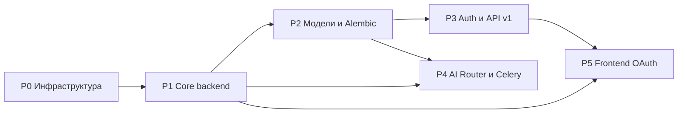

# APEX Foundation — план реализации

| Поле | Значение |
|------|----------|
| Версия плана | 1.0 |
| Дата | 2026-04-27 |
| Источник требований | `APEX_Foundation_TZ_EN.md` (Technical Specification v1.0) |
| Целевой артефакт | Рабочий Foundation: Docker, backend FastAPI, БД, auth, AI Router, Celery, минимальный Next.js |

---

## 1. Цель и границы

### 1.1 Цель

Собрать **единый слой Foundation**, от которого потом подключаются модули M1–M6: общая авторизация, БД, Redis, очереди, AI Router, логирование, базовые API и каркас frontend для Supabase Google OAuth — **без дублирования** инфраструктуры в модулях.

### 1.2 Входит в объём

- Монорепозиторий по дереву из ТЗ §2 (корректировки только если Windows/Docker требуют явных отличий).
- `docker-compose.yml` и volumes по ТЗ §3 (postgres, redis, backend, celery_worker, celery_beat, frontend).
- Backend: все файлы из ТЗ §6, которые относятся к Foundation (не к отдельным модулям).
- Схема БД §5: `organisations`, `users`, `companies`, `ai_usage` + базовые миксины.
- API v1: маршруты Foundation из ТЗ (`/api/v1/auth`, `users`, `companies` — по спецификации в документе).
- Alembic: репозиторий уже содержит `alembic/`, первая миграция `initial_schema` (без инструкции «запусти alembic init внутри контейнера» как единственный путь).
- Минимальный frontend §9: login, OAuth callback, middleware, заглушка dashboard.
- Критерии готовности — **чеклист ТЗ §14**.

### 1.3 Не входит (явно)

- Модули M1–M6 (в т.ч. M4 Content Engine) — только `app/modules/` с `.gitkeep` и пример подключения из ТЗ §8.
- Полный продуктовый UI, дизайн-система, i18n.
- Продакшен-хардненинг (HTTPS за reverse proxy, секреты в vault) — только задел через env и compose.

---

## 2. Зависимости между фазами

**Правило:** пока не подняты Postgres и Redis и не проходит `GET /health`, не блокируем остальное навечно — но миграции и защищённые роуты зависят от P2/P3.

---

## 3. Фазы работ (WBS)

### Фаза P0 — Репозиторий и Docker

| ID | Задача | Результат (deliverable) | Критерий приёмки |
|----|--------|-------------------------|------------------|
| P0.1 | Корень проекта: `backend/`, `frontend/`, compose в корне (или `apex/` — зафиксировать одну схему в первом коммите) | Единая структура каталогов согласована с ТЗ §2 | Дерево папок существует, пути в compose совпадают |
| P0.2 | `docker-compose.yml` по ТЗ §3 | Сервисы: postgres, redis, backend, celery_worker, celery_beat, frontend | `docker compose config` без ошибок; healthchecks у БД и Redis |
| P0.3 | `backend/Dockerfile`, `frontend/Dockerfile` | Образы собираются | `docker compose build` успешен |
| P0.4 | `.env.example` (корень) + при необходимости `frontend/.env.example` | Все переменные из ТЗ §4 перечислены с комментариями | Новый разработчик может заполнить env по шаблону |
| P0.5 | Volumes `postgres_data`, `redis_data` | Данные переживают `compose down` без `-v` | Проверка из ТЗ §14 (последний пункт) |

**Ссылки на ТЗ:** §2, §3, §4, §12 (шаги 1–5).

---

### Фаза P1 — Ядро backend без бизнес-логики модулей

| ID | Задача | Результат | Критерий приёмки |
|----|--------|-----------|------------------|
| P1.1 | `app/core/config.py` | `Settings` + `get_settings()` | Загрузка из `.env`, `allowed_origins_list` |
| P1.2 | `app/core/database.py` | Async engine + `AsyncSessionLocal` + `get_db` | Сессия отдаётся в зависимости, commit/rollback по ТЗ |
| P1.3 | `app/core/redis.py` | Клиент Redis (async или sync — по выбранной библиотеке, зафиксировать в коде) | Ping из lifespan или health расширенный (опционально) |
| P1.4 | `app/core/logging.py` | structlog, JSON в dev/prod по политике ТЗ | Логи структурированы |
| P1.5 | `app/core/exceptions.py` + обработчики в `main.py` | Единый формат ошибок API | Согласованные HTTP-коды и тело ответа |
| P1.6 | `app/core/celery_app.py` | Celery app с broker/backend из settings | Worker стартует без импорт-циклов |
| P1.7 | `app/main.py` | FastAPI app, CORS, mount `/api/v1`, **`GET /health`** | Ответ как в ТЗ §12: `status`, `version` |
| P1.8 | `requirements.txt` | Зависимости из ТЗ §10 + актуальные минорные версии | Установка в Docker без конфликтов |

**Ссылки на ТЗ:** §6 (database, config, logging, exceptions, celery), §10, §12 (шаг 7 — health).

---

### Фаза P2 — ORM-модели и миграции

| ID | Задача | Результат | Критерий приёмки |
|----|--------|-----------|------------------|
| P2.1 | `app/models/base.py` | `Base`, `TimestampMixin`, `UUIDMixin` | Соответствие ТЗ §5.1 |
| P2.2 | `app/models/organisation.py`, `user.py`, `company.py`, `ai_usage.py` (или один модуль с классами — по стилю репо) | Таблицы §5.2–5.5 | Индексы и ограничения UNIQUE как в SQL ТЗ |
| P2.3 | `app/schemas/*` | Pydantic v2: common, user, company | Валидация входа/выхода API |
| P2.4 | Alembic `env.py` | Импорт всех моделей для autogenerate | `alembic revision --autogenerate` видит таблицы |
| P2.5 | Ревизия `initial_schema` | Одна начальная миграция | `alembic upgrade head` на чистой БД без ошибок |

**Ссылки на ТЗ:** §5, §7, §14 (таблицы существуют).

---

### Фаза P3 — Supabase Auth и API v1

| ID | Задача | Результат | Критерий приёмки |
|----|--------|-----------|------------------|
| P3.1 | `app/core/auth.py` | Верификация JWT Supabase (`SUPABASE_JWT_SECRET` или JWKS — как надёжнее и проще для async; задокументировать в комментарии к коду) | Извлечение `sub` / `auth_id` |
| P3.2 | `app/core/dependencies.py` | `get_current_user`, привязка к `User` в БД | Без валидного токена — **401** на защищённых маршрутах |
| P3.3 | Bootstrap org/user | Первый логин: создание/поиск `Organisation` + `User` (правило зафиксировать: например одна default org или slug из env `DEFAULT_ORG_SLUG`) | Пользователь не «ломает» FK |
| P3.4 | `app/api/v1/auth.py` | Эндпоинты по ТЗ (текущий пользователь, logout если нужен на API-уровне) | Согласовано с frontend |
| P3.5 | `app/api/v1/users.py` | Профиль / список в рамках org — по ТЗ | Авторизация обязательна |
| P3.6 | `app/api/v1/companies.py` | CRUD companies с фильтром `org_id` из текущего пользователя | **401** без токена на `GET /api/v1/companies` |
| P3.7 | `app/api/router.py` | Сборка роутеров + префикс `/api/v1` | Swagger `/docs` показывает маршруты |

**Ссылки на ТЗ:** §6 (auth snippet), §8, §9 (поток токена), §14.

**Открытое решение (зафиксировать в реализации):** стратегия первой организации для нового Google-пользователя (single-tenant MVP vs мультитенант из коробки).

---

### Фаза P4 — AI Router, учёт использования, Celery-задачи

| ID | Задача | Результат | Критерий приёмки |
|----|--------|-----------|------------------|
| P4.1 | `app/core/ai_router.py` | `AIRouter`, `TaskType`, `AIModel`, routing table, fallback, расчёт стоимости по `MODEL_COSTS` | Вызов тестового `complete()` с ключом провайдера возвращает структуру из ТЗ |
| P4.2 | Запись в `ai_usage` | После успешного/неуспешного вызова — строка в БД (синхронно или через Celery — как в ТЗ §6: «через Celery чтобы не блокировать» — реализовать выбранный вариант последовательно) | Запись видна в таблице |
| P4.3 | `app/core/tasks.py` (или рядом с celery) | Минимум одна задача (ping / log_ai_usage) | Worker выполняет задачу, лог виден |
| P4.4 | Лимит `MAX_AI_COST_PER_DAY_USD` | Проверка перед вызовом (если в ТЗ явно — реализовать; иначе заглушка с TODO) | Поведение документировано в коде |

**Ссылки на ТЗ:** §6.3 (ai_router), §5.5, §14 (AI Router + Celery).

---

### Фаза P5 — Frontend (минимум для OAuth)

| ID | Задача | Результат | Критерий приёмки |
|----|--------|-----------|------------------|
| P5.1 | Зависимости `@supabase/supabase-js` (+ актуальные helpers для App Router, если ТЗ устарел — заменить на `@supabase/ssr` с эквивалентной логикой) | Клиент и env `NEXT_PUBLIC_*` | Сборка без ошибок |
| P5.2 | Страница login + кнопка Google | `signInWithOAuth` | Редирект на Supabase |
| P5.3 | Route `auth/callback` | Обмен code на сессию | Редирект на `/dashboard` |
| P5.4 | `middleware.ts` | Защита маршрутов по образцу ТЗ §9 | Не залогинен → `/login`; залогинен на `/login` → `/dashboard` |
| P5.5 | Заглушка `/dashboard` | Минимальный UI «OK» | Чеклист §14 |

**Ссылки на ТЗ:** §9, §12 шаг 7 (frontend), §14.

---

## 4. Тестирование и верификация

| Проверка | Команда / действие | Ожидание (ТЗ §14) |
|-----------|-------------------|-------------------|
| Compose | `docker compose up --build -d` + `docker compose ps` | Все нужные сервисы Running |
| Health | `curl http://localhost:8000/health` | 200, JSON с версией |
| Auth API | Запрос без `Authorization` на защищённый companies | 401 |
| DB | `alembic upgrade head` | Без ошибок |
| Таблицы | `\dt` или SQL | `organisations`, `users`, `companies`, `ai_usage` |
| AI | Тестовый вызов router (скрипт или `/docs`) | Ответ от провайдера при наличии ключа |
| Celery | Отправка тестовой задачи | Worker обработал |
| OAuth | Ручной проход Google → dashboard | Работает при настроенном Supabase |
| Персистентность | `compose down` → `up` | Данные БД на месте |

---

## 5. Матрица трассировки «ТЗ → фаза»

| Раздел ТЗ | Содержание | Фазы |
|-----------|------------|------|
| §2 | Структура проекта | P0, P1–P3 |
| §3 | Docker Compose | P0 |
| §4 | Переменные окружения | P0, P1, P5 |
| §5 | Схема БД | P2 |
| §6 | Core backend, AI Router | P1, P4 |
| §7 | Alembic | P2 |
| §8 | Точки расширения модулей | P3 (router), P0 (modules/.gitkeep) |
| §9 | Supabase Google OAuth (frontend) | P5 |
| §10–§11 | requirements, Dockerfile | P0, P1 |
| §12 | Запуск и проверка | все фазы |
| §14 | Чеклист готовности | раздел 4 настоящего плана |

---

## 6. Риски и смягчение

| Риск | Смягчение |
|------|-----------|
| Устаревшие примеры Next.js (`@supabase/auth-helpers-nextjs`) | Использовать текущий официальный SSR-пакет Supabase, сохранить поведение из ТЗ |
| JWT secret vs asymmetric keys | Поддержать то, что отдаёт проект Supabase; при необходимости два пути в конфиге |
| Импорт-циклы `celery_app` ↔ `tasks` | Явный слой `tasks` только после инициализации app |
| Windows + volume пути | Проверить compose на win32; при необходимости named volumes без bind для проблемных путей |

---

## 7. Определение готовности (Definition of Done)

Foundation считается **готовым**, когда выполнены **все пункты чеклиста ТЗ §14** и зафиксированы команды запуска в ответе команды / внутренней wiki (по желанию команды — отдельный README только по запросу).

---

## 8. Следующий шаг после Foundation

Подключение **M4** (или другого модуля) по инструкции ТЗ §13: новая папка в `app/modules/`, модели, миграция, `include_router` в `api/router.py`.
