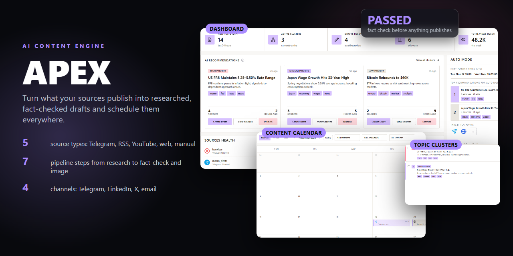
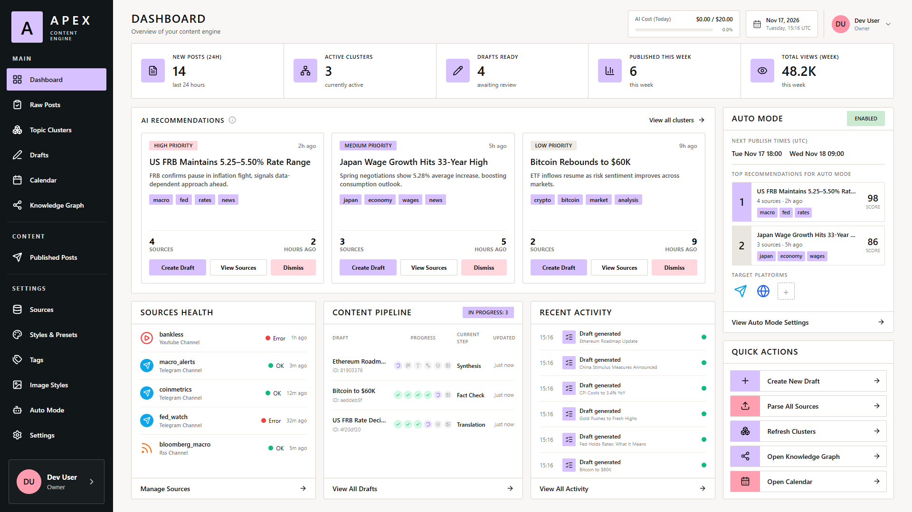
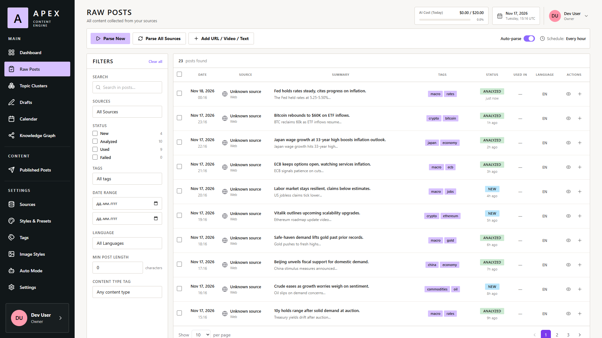
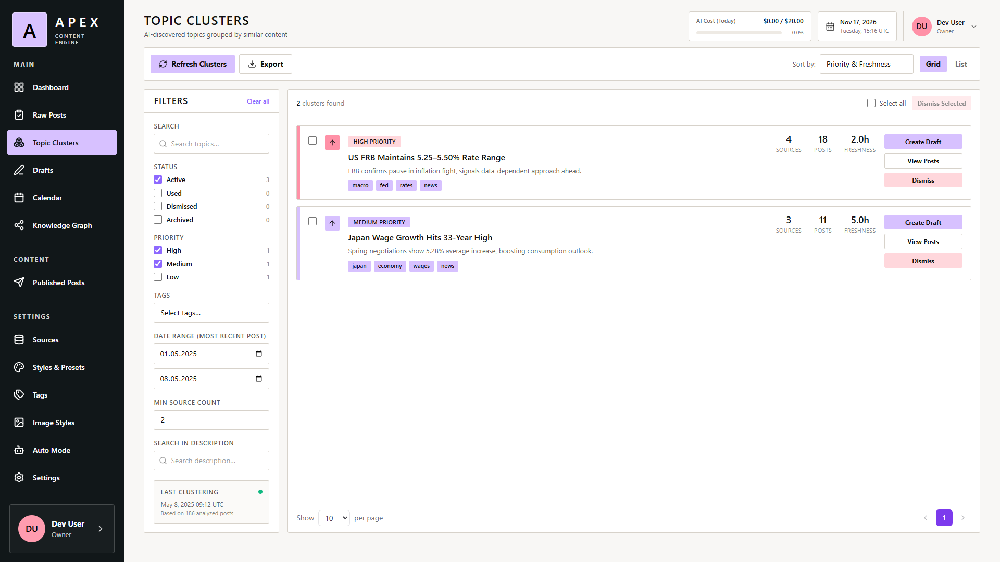
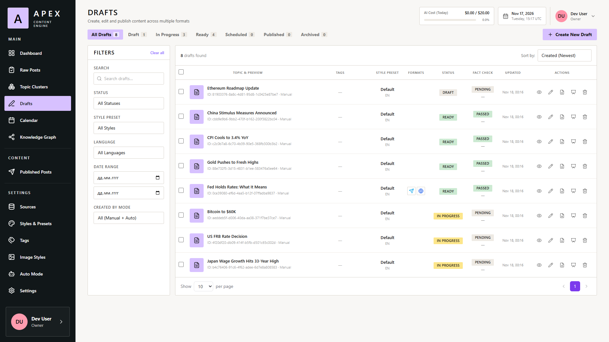
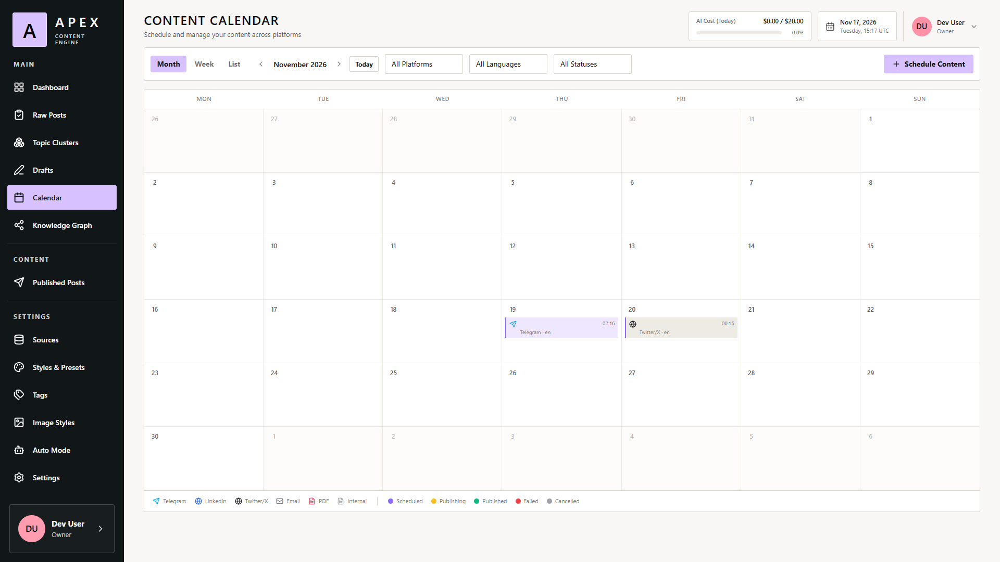
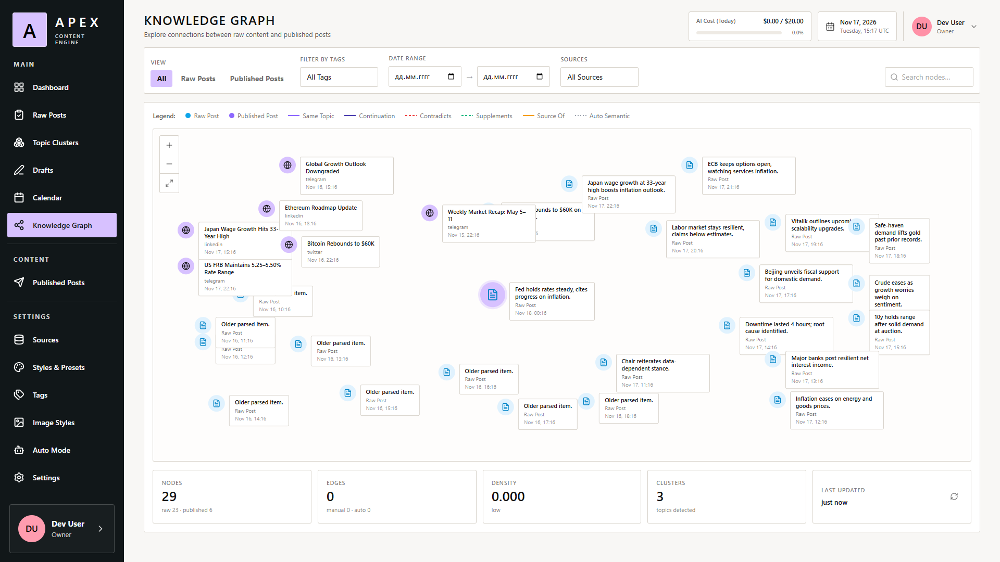
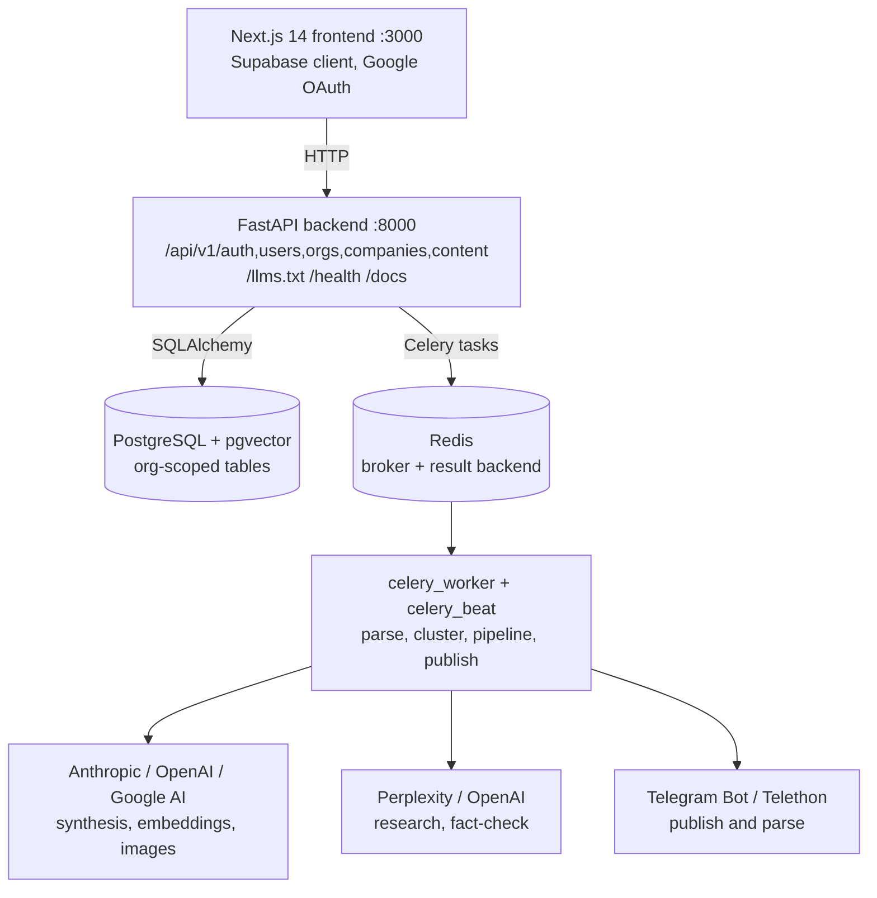

<p align="center"></p>

<h1 align="center">APEX Content Engine</h1>
<p align="center"><b>Self-hosted AI content automation platform</b><br>
Collects posts from Telegram, RSS, YouTube and the web, groups them into topics, and turns them into researched, fact-checked drafts published to Telegram, LinkedIn, X and email.</p>

<p align="center">
  <a href="#screenshots"><b>Screenshots</b></a> &nbsp;·&nbsp;
  <a href="#quickstart">Quickstart</a> &nbsp;·&nbsp;
  <a href="docs/USER_GUIDE.md">Docs</a> &nbsp;·&nbsp;
  <a href="backend/llms.txt">API reference</a> &nbsp;·&nbsp;
  <a href="CHANGELOG.md">Changelog</a>
</p>

<p align="center">
  <a href="https://github.com/imnotkeril/apex/actions/workflows/ci.yml"></a>
  <a href="LICENSE"></a>
  
  <a href="https://fastapi.tiangolo.com/"></a>
  <a href="https://nextjs.org/"></a>
  
</p>

<p align="center">
  <a href="docs/screenshots/dashboard.png"></a>
</p>

> There is no hosted live demo: APEX is self-hosted, so [run it locally](#quickstart). The screenshots below come from a local run with the seeded demo data of `backend/scripts/seed_dev.py`.
>
> Provider integrations (Telegram, LinkedIn, X, SMTP, AI) are covered by mocked tests only; supply and verify your own credentials before relying on them.

APEX is a self-hosted, multi-tenant AI content automation platform. It watches content
sources (Telegram channels, RSS feeds, YouTube, manual URLs/text), groups what it collects
into topic clusters, and runs an AI pipeline that turns a cluster (or a hand-picked set of
posts) into publish-ready drafts — researched, styled, translated, fact-checked, and
illustrated — which then get scheduled and published to Telegram, LinkedIn, Twitter/X and
email, tracked on a content calendar, and linked together in a knowledge graph.

Stack: FastAPI + PostgreSQL/pgvector + Redis + Celery on the backend, Next.js 14 on the
frontend, Google OAuth via Supabase for auth, Docker Compose for local dev.

## What it does

**Pipeline:** Sources → parsing → AI analysis (summary, tags, embeddings) → topic
clustering → draft generation (research → synthesis → styling → per-platform formatting →
translation → fact-check → optional image) → publishing.

- **Sources**: Telegram channels (Telethon), RSS, YouTube (transcript, falls back to
  Whisper), web articles, plus manual URL/YouTube/text input.
- **AI analysis**: every raw post gets a summary, tags, and an embedding (pgvector) for
  similarity search and clustering.
- **Topic clusters**: posts are grouped into clusters with a priority, freshness, and
  source-diversity score; clusters can be dismissed or turned into a draft.
- **Drafts**: pick a cluster or a set of raw posts, choose a style preset, target
  languages, and output formats (Telegram, LinkedIn, Twitter, email, PDF, ...); the
  pipeline runs research → synthesis → styling → formatting → translation → fact-check →
  image, all metered against the org's daily AI budget.
- **Publishing**: drafts publish now or at a chosen time to Telegram, LinkedIn, Twitter/X
  (single tweet or thread) and email (SMTP). Scheduled posts sit on the calendar and a
  once-a-minute Celery beat task publishes them when due. Twitter/X engagement metrics are
  synced daily; other platforms do not expose them. A draft can also be downloaded as PDF or PPTX, and a chart can be rendered from its `chart_data`.
- **Knowledge graph**: raw posts and published posts are linked (`same_topic`,
  `continuation`, `contradicts`, `supplements`, `source_of`, plus auto-generated semantic
  links) and browsable as a graph.
- **Auto mode**: an org-level config (mode, days, publish times, max posts/day, allowed
  tags, target platforms) that can run the pipeline unattended or stop at "ready draft".
- **Multi-tenant**: every resource is scoped to the caller's `org_id`; Team & Access,
  Billing (AI spend/budget), Notifications (Telegram), and Advanced (export, `/llms.txt`)
  live under Settings.

## Screenshots

All shots are 1920x1080 from a local Docker run (DEV_AUTH) with seeded demo data. Nothing is connected to a live provider account.

| | |
|---|---|
|  |  |
| **Dashboard.** Clusters, drafts, sources health, pipeline progress and AI spend at a glance | **Raw posts.** Everything collected from sources, with AI summary, tags and status |
|  |  |
| **Topic clusters.** AI-grouped topics ranked by priority and freshness, one click to a draft | **Drafts.** Pipeline status, fact-check result and publish formats per draft |
|  |  |
| **Calendar.** Scheduled posts per platform, published when they are due | **Knowledge graph.** Raw and published posts linked by topic |

## Architecture



Every AI call goes through an AI router that meters cost per org (`ai_usage` table) and
gates on the org's daily budget (`org.settings.ai_daily_limit_usd`, falling back to the
server's `MAX_AI_COST_PER_DAY_USD`); once the budget is hit, the router returns 429
(`AI_QUOTA_EXCEEDED`) instead of calling a paid model.

## Stack

| Layer | Tech |
| --- | --- |
| Backend | FastAPI 0.110, SQLAlchemy 2 (async), Alembic, Pydantic v2 |
| Database | PostgreSQL 16 + pgvector (`pgvector/pgvector:pg16` image) |
| Queue | Celery 5 + Redis 7 (broker + result backend, separate DB indices) |
| AI clients | `anthropic`, `openai`, Perplexity (via httpx), Google AI — routed per-task, org-key-aware |
| Auth | Google OAuth + JWT via Supabase; `DEV_AUTH=true` bypass for local dev only |
| Frontend | Next.js 14 (App Router), React 18, TypeScript, Tailwind CSS |
| Frontend data | TanStack Query, TanStack Table, Supabase JS/SSR client, Zod, Sonner (toasts) |
| Dev stack | Docker Compose (postgres, redis, backend, celery_worker, celery_beat, frontend) |

## Quickstart

1. **Configure environment** — see [Environment setup](#environment-setup) below; you need
   at minimum a Supabase project (auth) and one AI key (Anthropic and/or OpenAI) for
   anything beyond the demo UI to work.

2. **Start the stack:**

   ```bash
   docker compose up --build -d
   ```

3. **Apply migrations:**

   ```bash
   docker compose exec backend alembic upgrade head
   ```

4. **Open it:**

   | What | URL |
   | --- | --- |
   | Frontend (dashboard) | <http://localhost:3000> |
   | Backend health check | <http://localhost:8000/health> |
   | API docs (Swagger, when `DEBUG=true`) | <http://localhost:8000/docs> |
   | API surface for LLM agents | <http://localhost:8000/llms.txt> |

## Environment setup

Two env files matter for Docker Compose: **`docker.env`** at repo root (backend, Postgres,
Redis, Celery) and **`frontend/.env.docker`** (Next.js `NEXT_PUBLIC_*` vars). Running the
backend outside Docker uses `.env` at repo root instead (copy from `.env.example`); running
the frontend outside Docker uses `frontend/.env.local` (copy from
`frontend/.env.local.example`).

Required to get past login and generate real content: 4 Supabase values (`SUPABASE_URL`,
`SUPABASE_ANON_KEY`, `SUPABASE_SERVICE_ROLE_KEY`, `SUPABASE_JWT_SECRET`) + matching
`NEXT_PUBLIC_SUPABASE_URL`/`NEXT_PUBLIC_SUPABASE_ANON_KEY` on the frontend, Google OAuth
wired into that Supabase project, and at least `ANTHROPIC_API_KEY` (synthesis) +
`OPENAI_API_KEY` (embeddings/fallback). Telegram, Perplexity, Grok, and Google AI keys are
optional and unlock specific features (publishing, fact-check, transcription fallback).

For local dev without any of that, set `DEV_AUTH=true` in `docker.env` to bypass Supabase
with a fixed dev user/org — never enable this in production.

Full step-by-step (every variable, where to get it, common errors):
[`docs/setup/ENV_SETUP.md`](docs/setup/ENV_SETUP.md) ·
[`docs/setup/SECRETS_SETUP.md`](docs/setup/SECRETS_SETUP.md) (quick "what do I actually need" version).

Org-level integration keys (AI providers, Telegram, Twitter, LinkedIn, SMTP email) can also be pasted
directly into the running app under **Settings → Integrations** — they're encrypted at rest
and override the server env var for that org only.

## Frontend rebuild gotcha

`docker-compose.override.yml` builds the frontend into the image and serves it in
production mode (`npm run start`) instead of `npm run dev`, because Next.js over a Docker
bind mount on Windows/WSL2 fails to compile/serve nested routes. This means **a plain
rebuild is not enough** — the old build is still being served from an anonymous volume.
After any frontend change:

```bash
docker compose build frontend
docker compose up -d --force-recreate --renew-anon-volumes frontend
```

Plain `docker compose up -d` reuses the old `/app/.next` volume and serves the stale build.
Delete `docker-compose.override.yml` to go back to hot-reloading `npm run dev` for frontend
development.

## Testing

```bash
# Backend test suite (123 tests; mocked providers, no API keys needed)
cd backend && python -m pytest -q

# Frontend: type-check, unit tests (11), lint, production build
cd frontend && npx tsc --noEmit && npm test && npx next lint && npx next build

# Or inside the running stack
docker exec apex_backend pytest -q
```

## Project layout

```text
APEX/
├── docker-compose.yml            # postgres, redis, backend, celery_worker, celery_beat, frontend
├── docker-compose.override.yml   # frontend: prod build + anon volume (see gotcha above)
├── docker.env                    # backend/worker env (Docker)
├── .env.example                  # template for running backend outside Docker
├── backend/
│   ├── app/
│   │   ├── main.py               # FastAPI app, CORS, /health, /llms.txt, /api/content/export alias
│   │   ├── api/                  # api_router + /api/v1/{auth,users,orgs,companies}
│   │   ├── core/                 # config, database, auth, ai_router, org_secrets, celery_app
│   │   ├── models/                # SQLAlchemy models (user, organisation, ai_usage, company)
│   │   ├── modules/content/       # the content engine module
│   │   │   ├── router.py         # /api/v1/content/* endpoints
│   │   │   ├── models.py          # ContentSource, RawPost, TopicCluster, ContentDraft, ...
│   │   │   ├── tasks.py           # Celery tasks (parse, cluster, pipeline, publish)
│   │   │   ├── parsers/           # telegram, rss, youtube, web, email_imap
│   │   │   └── services/          # pipeline, clustering, embeddings, analysis, publish, images
│   │   └── schemas/                # Pydantic organisation/user/common schemas
│   ├── llms.txt                   # source file served at GET /llms.txt
│   └── requirements.txt
├── frontend/
│   ├── app/
│   │   ├── (auth)/login/          # Google OAuth sign-in
│   │   └── (dashboard)/           # sidebar-nested app pages (see docs/USER_GUIDE.md)
│   ├── components/                 # layout (sidebar, page-header), ui (button, table, modal, ...)
│   └── lib/api/                    # hooks.ts (TanStack Query), types.ts, content.ts (fetch client)
└── docs/                           # setup guides, screenshots
```

## Current status / roadmap

- The full pipeline (parse → analyze → cluster → draft → publish) is implemented end to end.
  It has been unit-tested with mocked providers only: nothing in this repo has been verified
  against live Telegram / LinkedIn / Twitter / SMTP / AI accounts yet. Pages show real data only; an empty install shows empty states.
- Auto Mode records every cycle decision (draft started, or slot skipped and why) in
  `auto_mode_runs`; the Overview/Rules/Activity tabs and metrics are computed from that
  history. Apply migration `005_auto_runs` (`alembic upgrade head`).
- Org-level Telegram notifications (draft ready / published / pipeline failed / budget
  alert), the daily AI budget, Team & Access (roles, deactivate), and content export are all
  live end-to-end.
- Production: `docker-compose.prod.yml` (migrate job, no bind mounts, healthchecks) and
  `.github/workflows/ci.yml` exist but have not been run. TLS termination and the hosting
  target are not decided. Backend tests: `cd backend && python -m pytest -q`; frontend: `cd frontend && npm test`.

## Contributing

See [CONTRIBUTING.md](CONTRIBUTING.md) for setup and checks, and [SECURITY.md](SECURITY.md) for private vulnerability reporting.

## License

[MIT](LICENSE)

## Security

Set `ENVIRONMENT=production` in deployments: the backend then refuses to start with `DEV_AUTH=true` or a weak `SECRET_KEY`. Never commit `.env` files.
